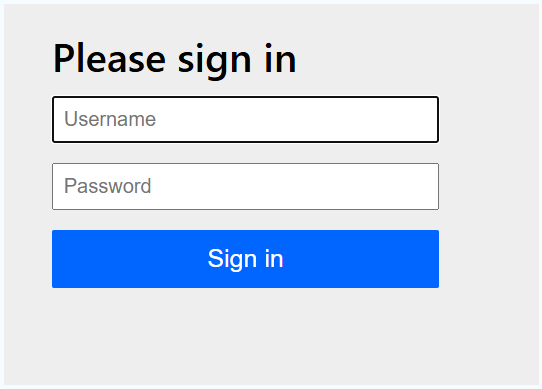
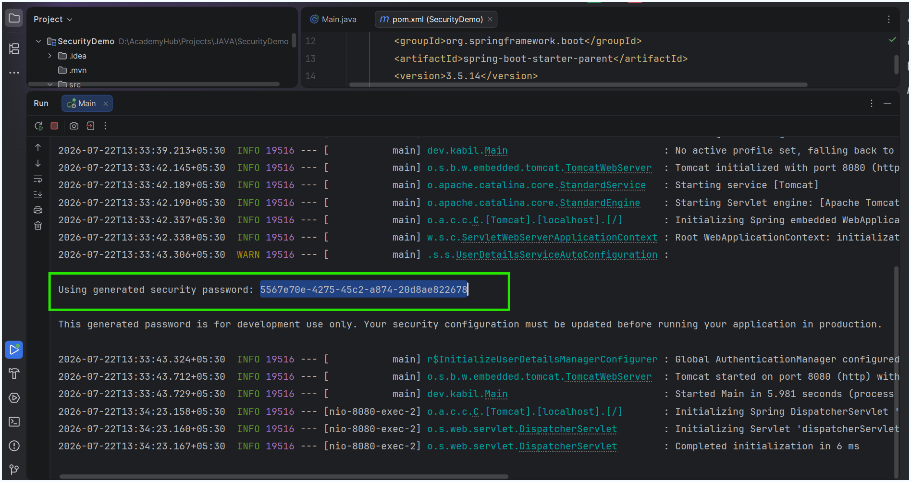

I'm currently learning **Spring Security**, and these are my beginner-friendly notes after understanding the fundamentals. I wanted to organize everything into one place so it can help other students who are just getting started.

---

# What is Spring Security?

**Spring Security** is a security framework for Spring Boot applications. It helps protect your application by handling two major responsibilities:

* **Authentication** – Verifying who the user is.
* **Authorization** – Deciding what the authenticated user is allowed to access.

These are the three topics I learned first:

* Fundamentals
* Basic Setup
* Authorization Rules

---

# Authentication vs Authorization

Let's understand this with a simple example.

Imagine **Nimethan**, a university student, logging into the university portal.

He enters his **username and password**, and the system verifies his credentials before allowing him to log in.

✅ This is **Authentication** — verifying **who the user is**.

After logging in, Nimethan can **view his own grades**, but he **cannot modify them** or access another student's records because he is only a student.

✅ This is **Authorization** — deciding **what the authenticated user is allowed to do**.

---

# Authentication

Authentication answers the question:

> **"Who are you?"**

Examples:

* Logging in with a username and password
* Verifying user identity
* Creating an authenticated session

---

# Authorization

Authorization answers the question:

> **"What are you allowed to do?"**

Examples:

* Accessing `/admin`
* Viewing protected resources
* Checking user roles and permissions

If a normal user tries to access an admin endpoint, Spring Security checks whether that user has the required role before granting access.

---

# Basic Setup

When Spring Security is added to a Spring Boot project, **every endpoint becomes protected by default**.

## Step 1 — Add the dependency

```xml
<dependency>
    <groupId>org.springframework.boot</groupId>
    <artifactId>spring-boot-starter-security</artifactId>
</dependency>
```

After adding the dependency and running the application, visiting:

```
http://localhost:8080
```

redirects you to Spring Security's default login page.



Spring Boot automatically creates a temporary user.

**Default Username**

```
user
```

**Default Password**

The password is printed in the application console every time the application starts.



---

# Step 2 — Create a Security Configuration

Create a class called `SecurityConfig.java`.

```java
@EnableWebSecurity
public class SecurityConfig {

    @Bean
    public SecurityFilterChain filterChain(HttpSecurity http) throws Exception {

        http
            .authorizeHttpRequests(auth -> auth
                .anyRequest().authenticated())
            .formLogin(withDefaults());

        return http.build();
    }
}
```

This configuration means:

* Every request requires authentication.
* Spring Security provides the default login page.
* All security rules are managed through a `SecurityFilterChain`.

---

# Understanding the Security Configuration

## @EnableWebSecurity

Enables Spring Security's web security support and tells Spring that you want to customize the security configuration instead of relying only on the defaults.

---

## SecurityConfig

A regular Java configuration class where all security rules are defined.

You can think of it as the application's **security blueprint**.

---

## @Bean

Marks a method whose returned object will be managed by Spring.

Here, we're telling Spring to use our custom `SecurityFilterChain` for handling security.

---

## SecurityFilterChain

This is the modern way to configure Spring Security.

It replaces the older `WebSecurityConfigurerAdapter`.

A filter chain is simply a sequence of security filters that process every incoming HTTP request before it reaches your controller.

---

## HttpSecurity

`HttpSecurity` provides methods for configuring your application's security.

Some commonly used methods include:

* `authorizeHttpRequests()`
* `formLogin()`
* `httpBasic()`
* `logout()`
* `csrf()`

---

## authorizeHttpRequests()

Defines the authorization rules.

```java
.authorizeHttpRequests(auth ->
    auth.anyRequest().authenticated()
)
```

This configuration tells Spring Security:

> Every request must be authenticated before it can access any endpoint.

---

## formLogin(withDefaults())

```java
.formLogin(withDefaults())
```

This enables Spring Security's default login page.

When an unauthenticated user attempts to access a protected resource:

1. Spring redirects the user to the login page.
2. The user enters their credentials.
3. Spring authenticates the user.
4. The authenticated user's information is stored inside the `SecurityContext`.
5. Future requests recognize the logged-in user.

---

## http.build()

```java
return http.build();
```

This finalizes the security configuration and returns the `SecurityFilterChain` bean that Spring Boot will use.

Without calling `build()`, the configuration would never be applied.

---

# Request Flow

Here's what happens when a user visits `/home`.

1. The user requests `/home`.
2. Spring Security checks the configured authorization rules.
3. The endpoint requires authentication.
4. Since the user is not logged in, Spring redirects them to the login page.
5. The user enters valid credentials.
6. Spring authenticates the user and stores the authentication information in the `SecurityContext`.
7. The user is redirected back to `/home`.

---

# Authorization Rules

In a real application, not every user should have the same level of access.

For example:

* **Users** → Can access general pages.
* **Admins** → Can access administrative pages.

This is where authorization rules become important.

The basic process is:

1. Create users with different roles.
2. Configure endpoint access rules.
3. Create controllers.
4. Test the application.

---

# Creating Multiple Users

```java
@Bean
public UserDetailsService users() {

    UserDetails user = User.withUsername("user")
            .password(passwordEncoder().encode("pass"))
            .roles("USER")
            .build();

    UserDetails admin = User.withUsername("admin")
            .password(passwordEncoder().encode("admin"))
            .roles("ADMIN")
            .build();

    return new InMemoryUserDetailsManager(user, admin);
}

@Bean
public PasswordEncoder passwordEncoder() {
    return new BCryptPasswordEncoder();
}
```

---

# Understanding the Classes

## UserDetails

`UserDetails` represents a user that Spring Security can authenticate.

It stores information such as:

* Username
* Password
* Roles
* Account status

Example:

```java
UserDetails user = User.withUsername("user")
        .password(passwordEncoder().encode("pass"))
        .roles("USER")
        .build();
```

This creates a user with:

* Username: `user`
* Password: `pass`
* Role: `USER`

---

## UserDetailsService

`UserDetailsService` is an interface used by Spring Security to retrieve user information during authentication.

When a user attempts to log in, Spring Security asks:

> "Can you provide the user details for this username?"

An implementation of this interface is responsible for returning the corresponding `UserDetails` object.

---

## InMemoryUserDetailsManager

`InMemoryUserDetailsManager` is a simple implementation of `UserDetailsService`.

Instead of retrieving users from a database, it stores them directly in memory.

This makes it ideal for learning, testing, and small demo applications.

---

## PasswordEncoder

Passwords should never be stored as plain text.

`PasswordEncoder` securely hashes passwords before storing them.

In this example, we use:

```java
BCryptPasswordEncoder
```

which is one of the most commonly used password hashing algorithms in Spring Security.

---

# Final Thoughts

These are the core concepts I learned while getting started with Spring Security.

Understanding **Authentication**, **Authorization**, and the **SecurityFilterChain** makes it much easier to understand the more advanced topics that come next, such as:

* JWT Authentication
* Stateless Security
* Custom Login
* Role-Based Access Control (RBAC)
* OAuth2
* Method-Level Security

I'm still learning, so if you notice anything that could be improved or explained better, feel free to leave a comment. I'm always happy to learn from others.

