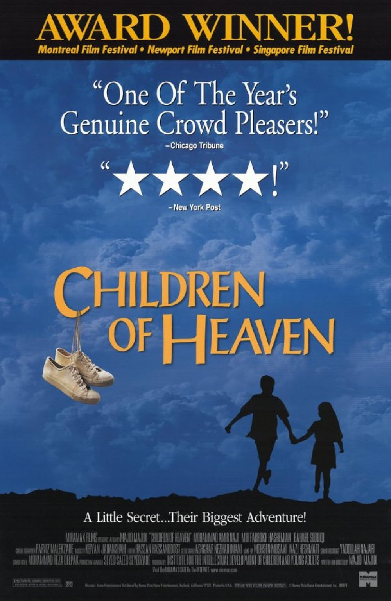

சினிமா என்றுமே ஒரு சுவாரஸ்யமான பொழுதுபோக்கு மட்டுமல்ல, அது பல உலகங்களுக்கு நம்மை அழைத்துச் செல்லும் ஒரு கால இயந்திரம். எனக்கு சினிமா பார்ப்பது மிகவும் பிடிக்கும். சிறு வயதிலிருந்தே திரையில் விரியும் கதைகளைப் பார்ப்பதில் எனக்கு எல்லையில்லா சந்தோஷம். ஆரம்ப காலகட்டங்களில் வெறுமனே தமிழ் சினிமாக்களை மட்டுமே பார்த்து ரசித்துக் கொண்டிருந்த எனக்கு, உலக சினிமா ஒரு புதிய திறப்பாக அமைந்தது.

முதல்முறையாக நான் பார்த்த உலக சினிமா, எல்லாரையும் போல Marvel அல்லது DC படங்களாக இருக்க வாய்ப்பிருக்கலாம். ஆனால், என் நினைவில் ஆழமாகப் பதிந்த, எனக்கு இன்னமும் பசுமையாக ஞாபகம் இருக்கும் முதல் திரைப்படம் **"The Shawshank Redemption"**. அந்தத் திரைப்படத்தைப் பற்றி வேறு ஒரு நாள் நிச்சயமாக விரிவாகப் பேசலாம். ஆனால், இன்று நான் உங்களிடம் பகிர்ந்துகொள்ள நினைக்கும் திரைப்படம் **"Children of Heaven"**. இது ஒரு ஈரானியத் திரைப்படம்.

நான் பார்த்துப் பிரமித்த, ஆச்சரியப்பட்ட திரைப்படங்களில் இது மிக முக்கியமானது. இதற்கு முன் நான் வேற்று மொழிப் படங்களை (ஆங்கிலம் தவிர்த்து) இவ்வளவு ஆழமாகப் பார்த்ததில்லை. அதனால், இந்தத் திரைப்படம் எனக்கு முற்றிலும் ஒரு வித்தியாசமான, உணர்வுபூர்வமான அனுபவமாக இருந்தது.

நான் ஒரு சினிமா விமர்சகனோ அல்லது தொழில்நுட்பக் கலைஞனோ அல்ல. திரைக்கதை அமைப்பு, கேமரா கோணங்கள் போன்ற நுட்பங்களை எல்லாம் இங்கு நான் விளக்கப் போவதில்லை. ஆனால் ஒரு சிறந்த திரைக்கதை எப்படி மனித உணர்வுகளை நேரடியாகத் தொட முடியும் என்பதற்கு இது ஒரு அருமையான உதாரணம். எனக்கு மிகவும் ஆச்சரியமூட்டிய விஷயம் என்னவென்றால், இதன் மிக எளிமையான கதைக்களம் தான். ஒரு அண்ணனுக்கும் தங்கைக்கும் இடையே உள்ள பாசப் போராட்டமே இந்தக் கதை.

தங்கையின் செருப்பைத் தவறுதலாகத் தொலைத்துவிடும் அண்ணன், அவளுக்கு எப்படிப் புதுச் செருப்பு ஒன்றை வாங்கித் தருகிறான், அதற்காக அந்தச் சிறு வயதில் அவன் என்னென்ன தியாகங்களையும் வலிகளையும் சந்திக்கிறான் என்பதைக் காட்டும் படம் இது. அண்ணன், தங்கை ஒரே ஒரு ஜோடி Shoe வை வைத்துக்கொண்டு, ஒருவரையொருவர் விட்டுக்கொடுக்காமல் பள்ளிக்கு ஓடும் காட்சிகள் 😔.

இந்தக் கதை எனக்கு ஒரு மிக முக்கியமான வாழ்க்கை உண்மையை உணர்த்தியது. நாம் நமது வாழ்க்கையில் இல்லாததை மட்டுமே எண்ணிக் கவலைப்பட்டுக் கொண்டிருக்கிறோம். நம்மிடம் இருப்பதைக் கொண்டும், நம்முடன் இருப்பவர்களைக் கொண்டும் எப்படி மகிழ்ச்சியாக வாழ்வது என்பதை நாம் பல நேரங்களில் நினைப்பதே இல்லை. ஒரு சாதாரண செருப்பு அந்தக் குழந்தைகளின் வாழ்க்கையில் எவ்வளவு பெரிய உலகமாக மாறுகிறது என்பதைப் பார்க்கும்போது, நாம் எவ்வளவு சலுகைகளுடன் வாழ்கிறோம் என்பது புரிகிறது.

எந்தவிதமான ஆடம்பரமும் இல்லாமல், மிகத் தூய்மையான அன்பையும், வறுமையிலும் செழிக்கின்ற மனிதநேயத்தையும் வடித்த விதம் அபாரம். இறுதியாக ஒரு தகவல், இந்தப் படத்தின் தாக்கத்தில் தமிழில் **"அக்கா குருவி"** என்ற பெயரில் ஒரு படம் வந்திருக்கிறது. நான் இன்னும் அந்தப் படத்தைப் பார்க்கவில்லை, உங்களுக்கு விருப்பம் இருந்தால் அதையும் நீங்கள் பார்க்கலாம். ஆனால், என்னைப் பொறுத்தவரை இந்த Original  ஈரானியப் படமான **"Children of Heaven"**-ஐ உங்கள் வாழ்நாளில் ஒருமுறையாவது பார்த்துவிடுங்கள் என்று நான் உறுதியாகப் பரிந்துரைப்பேன். 

